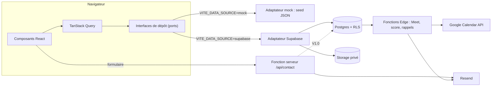

# TRD : Document d'exigences techniques
**Plateforme CAP-MARJ**

| Champ | Valeur |
|---|---|
| Version du document | 0.1 |
| Statut | Brouillon, à valider avant le démarrage de la V0 |
| Dernière mise à jour | 13 novembre 2026 |
| Phases couvertes | V0 Vitrine, V1.0 à V1.2, V2 |
| Documents liés | [PRD](01_PRD_Exigences_Produit.md) · [Appflow](03_Appflow.md) · [UX/UI](04_UX_UI_Design.md) · [Backend Schema](05_Backend_Schema.md) · [Plan](06_Plan_Implementation.md) |
| Rôle de ce document | Source de vérité du **comment** : stack, architecture, sécurité, qualité, déploiement |

---

## 1. Principes d'architecture

1. **Le frontend ignore d'où viennent les données.** Les composants appellent des fonctions de données ; en V0 elles lisent un jeu de données local, en V1 elles interrogent Supabase. Aucun écran n'est refait.
2. **Le contrat de données est écrit une seule fois**, sous forme de schémas Zod. Il valide le seed en V0 et reflète les tables en V1.
3. **Évolution additive.** On ajoute des colonnes, des tables, des valeurs d'énumération ; on ne renomme ni ne supprime sans plan de migration.
4. **La sécurité est dans la base, pas dans l'interface.** Masquer un bouton ne protège rien ; chaque règle d'accès est appliquée par les politiques RLS.
5. **Les secrets ne quittent jamais le serveur.** Tout appel nécessitant un secret passe par une fonction serveur.
6. **Les fonctionnalités se pilotent par configuration** (interrupteurs), pas par suppression de code.

## 2. Stack technique

| Couche | Choix | Raison |
|---|---|---|
| Langage | TypeScript en mode strict | Les types servent de contrat entre frontend et backend |
| Frontend | React 18 + Vite | Maîtrise existante, démarrage rapide, build statique |
| Routage | React Router | Standard, chargement par route |
| Données côté client | TanStack Query | Rend le passage mock vers Supabase transparent (cache, états de chargement) |
| Formulaires | React Hook Form + Zod | Validation partagée avec le contrat de données |
| Styles | Tailwind CSS alimenté par des variables de design (voir UX/UI) | Cohérence, aucun code couleur dans les composants |
| Icônes | Un seul jeu de pictogrammes filaires (ex. Lucide), usage fonctionnel | Cohérence visuelle |
| Backend V1 | Supabase : Postgres, Auth, Storage, RLS, fonctions Edge | Sécurité au niveau des lignes, stockage privé, authentification intégrée |
| Fonctions serveur V0 | Fonction Vercel `/api/contact` | Formulaire de contact sans exposer de clé |
| Courriel transactionnel | Resend | Palier gratuit suffisant au démarrage ; nécessite un domaine vérifié |
| Anti-spam | Cloudflare Turnstile | Sans traceur publicitaire, adapté à un site de santé |
| Hébergement | Vercel | Déploiements de prévisualisation par branche |
| Qualité | ESLint, Prettier, Vitest, Testing Library, Playwright | Voir section 10 |
| Polices | Auto-hébergées (WOFF2) | Aucune requête vers un tiers, conforme à la politique de sécurité de contenu |

## 3. Architecture



**Ce qui est réutilisé d'une version à l'autre**

| Élément | V0 | V1 | Changement |
|---|---|---|---|
| Composants et pages | Oui | Oui | Aucun |
| Schémas Zod (contrats) | Valident le seed | Valident les réponses Supabase | Aucun |
| Interfaces de dépôt | Une implémentation (mock) | Deux (mock et Supabase) | Ajout |
| Seed JSON | Source de contenu | Source du `seed.sql` et des tests | Réutilisé |
| Configuration des fonctionnalités | Interrupteurs locaux | Interrupteurs locaux + base | Extension |

### 3.1 Contrat et adaptateur (exemple de référence)

```ts
// src/data/contracts/service.ts
import { z } from 'zod'

export const WorkflowType = z.enum(['request', 'appointment', 'registration', 'test'])

export const ServiceSchema = z.object({
  id: z.string().uuid(),
  slug: z.string().regex(/^[a-z0-9-]+$/),
  name: z.string().min(2),
  summary: z.string().min(10),
  audience: z.string().nullable(),
  inclusions: z.array(z.string()).default([]),
  isPaid: z.boolean(),
  priceAmount: z.number().nonnegative().nullable(),
  priceCurrency: z.enum(['HTG', 'USD']).default('HTG'),
  priceNote: z.string().nullable(),
  workflowType: WorkflowType,
  ctaLabel: z.string(),
  position: z.number().int(),
  isPublished: z.boolean(),
})
export type Service = z.infer<typeof ServiceSchema>

// src/data/ports/services.ts
export interface ServicesRepository {
  list(): Promise<Service[]>
  getBySlug(slug: string): Promise<Service | null>
}

// src/data/index.ts
export function getRepositories() {
  return import.meta.env.VITE_DATA_SOURCE === 'supabase'
    ? createSupabaseRepositories()
    : createMockRepositories()
}
```

Règle : un composant n'importe jamais `@supabase/supabase-js` ni le seed ; il passe par un hook de données.

## 4. Structure du dépôt

```
cap-marj/
├─ src/
│  ├─ app/                 routeur, fournisseurs, mises en page, garde de routes
│  ├─ features/
│  │   ├─ home/ about/ team/ services/ faq/ contact/ legal/        (V0)
│  │   ├─ admin/ blog/ requests/                                    (V1.0)
│  │   ├─ account/ appointments/ payments/                          (V1.1)
│  │   ├─ events/ registrations/                                    (V1.2)
│  │   └─ tests/ qa/                                                (V2)
│  ├─ data/
│  │   ├─ contracts/       schémas Zod et types
│  │   ├─ ports/           interfaces de dépôt
│  │   ├─ adapters/mock/   lecture du seed
│  │   ├─ adapters/supabase/
│  │   └─ seed/            organisation.json, equipe.json, services.json, faq.json, axes.json
│  ├─ config/              features.ts, site.ts (décisions métier)
│  ├─ shared/              ui/, hooks/, lib/, styles/
│  └─ main.tsx
├─ api/                    fonctions serveur Vercel (contact)
├─ supabase/               migrations/, functions/, tests/, seed.sql
├─ public/                 favicon, images optimisées, polices
├─ docs/                   ces six documents
├─ .env.example            toutes les variables, sans valeur
└─ vercel.json             en-têtes de sécurité
```

Une feature n'importe pas une autre feature : elle passe par `shared/` ou `data/`.

## 5. Configuration et interrupteurs

| Variable | Public ? | Rôle |
|---|---|---|
| `VITE_DATA_SOURCE` | Oui | `mock` (V0) ou `supabase` |
| `VITE_DEMO_MODE` | Oui | `true` : rubriques futures affichées en « Bientôt » |
| `VITE_SUPABASE_URL`, `VITE_SUPABASE_ANON_KEY` | Oui | Clé publique par conception, protégée par RLS |
| `VITE_TURNSTILE_SITE_KEY` | Oui | Clé publique du contrôle anti-spam |
| `TURNSTILE_SECRET_KEY` | **Non** | Vérification côté serveur |
| `RESEND_API_KEY`, `CONTACT_TO_EMAIL` | **Non** | Envoi des demandes de contact |
| `SUPABASE_SERVICE_ROLE_KEY` | **Non** | Uniquement fonctions serveur ; jamais dans le client |
| `GOOGLE_OAUTH_*` | **Non** | Création des liens Meet |

Règle : tout ce qui commence par `VITE_` est visible de tous. Rien de secret n'y figure.

```ts
// src/config/features.ts
export const features = {
  contactForm: true,
  blog: false,          // V1.0
  accountArea: false,   // V1.1
  appointments: false,  // V1.1
  registrations: false, // V1.2
  tests: false,         // V2
  qa: false,            // V2
} as const
// Le menu affiche une rubrique si la fonctionnalité est active,
// ou en "Bientôt" si VITE_DEMO_MODE est vrai, sinon la masque.
```

Les décisions métier (visibilité du score, modération et anonymat du Q/R) vivent dans `config/site.ts`, jamais en dur dans un composant.

## 6. Sécurité

| Menace | Contrôle |
|---|---|
| Lecture ou modification de données d'autrui | RLS activée sur **toutes** les tables ; politiques testées ; principe du moindre privilège |
| Élévation de privilèges | Les rôles sont dans `user_roles`, modifiables par l'administrateur seulement. Jamais dans `user_metadata`, que l'utilisateur peut modifier |
| Fuite de justificatifs | Bucket privé, URL signées de courte durée, noms de fichiers aléatoires, type et taille validés côté serveur |
| XSS | Échappement React par défaut ; contenu du blog assaini avant rendu ; politique de sécurité de contenu stricte |
| Spam et abus | Turnstile + limitation de débit sur contact, inscription, Q/R |
| Énumération de comptes | Messages identiques que le compte existe ou non (connexion, réinitialisation) |
| Force brute | Limites d'authentification ; mot de passe d'au moins 10 caractères ; double authentification obligatoire pour l'administrateur et Finance |
| Dépendances vulnérables | Fichier de verrouillage, `npm audit` en CI, mises à jour surveillées |
| Secrets exposés | Variables d'environnement hébergeur ; analyse de secrets avant chaque fusion |
| Fraude sur les preuves | Référence de transaction obligatoire et unique par moyen de paiement ; journal d'audit ; aucune suppression physique des paiements |
| Fuite par courriel | Notifications neutres : aucun détail de santé dans les courriels. SPF, DKIM et DMARC sur le domaine |
| Redirections ouvertes | Après connexion, seules des routes internes sont acceptées |

**En-têtes HTTP** (`vercel.json`) : `Content-Security-Policy` (sources limitées au site, à Supabase, à Turnstile), `Strict-Transport-Security`, `X-Content-Type-Options: nosniff`, `Referrer-Policy: strict-origin-when-cross-origin`, `Permissions-Policy` restrictive, `frame-ancestors 'none'`.

**Données sensibles**
- Aucune donnée clinique en V1. Les données de test et de Q/R privé arrivent en V2, avec revue de sécurité dédiée avant mise en production.
- Les données personnelles ne figurent ni dans les journaux ni dans les outils de suivi d'erreurs.
- Chaque accès à une preuve de paiement et chaque validation sont tracés.
- Hébergement des données hors d'Haïti : à mentionner dans la politique de confidentialité (TRD-Q07).

## 7. Performance et référencement

| Indicateur | Objectif |
|---|---|
| Plus gros élément visible (LCP) | ≤ 2,5 s sur mobile moyen |
| Décalage de mise en page (CLS) | ≤ 0,1 |
| JavaScript initial (compressé) | ≤ 150 Ko |
| Image courante / image principale | ≤ 150 Ko / ≤ 250 Ko, en WebP ou AVIF, largeurs adaptatives |
| Polices | 2 familles, sous-ensemble latin, ≤ 100 Ko au total |
| Lighthouse (mobile) | Performance ≥ 90, Accessibilité ≥ 95, Bonnes pratiques ≥ 95, SEO ≥ 90 |

- Découpage par route, images chargées à la demande sous la ligne de flottaison.
- Métadonnées, Open Graph, `sitemap.xml`, `robots.txt`, données structurées « Organization ».
- **Point de vigilance** : une application mono-page est moins bien indexée. Pré-rendu statique des pages publiques à valider par un court essai en V0 (ex. `vite-react-ssg`). Si le référencement du blog devient un objectif majeur, migrer vers Next.js : contrats, adaptateurs et composants restent réutilisables (ADR-001).

## 8. Intégrations

| Intégration | Usage | Version | Risque et repli |
|---|---|---|---|
| Resend | Contact, confirmations, rappels | V0 | Domaine à vérifier ; sans domaine, envoi de démonstration uniquement vers le développeur |
| Turnstile | Anti-spam | V0 | Repli : jeton honeypot + limitation de débit |
| Google Calendar / Meet | Lien Meet à la confirmation | V1.1 | Avec un compte Gmail, l'autorisation OAuth doit être publiée pour que le jeton n'expire pas ; sinon repli : le professionnel colle un lien Meet |
| MonCash, NatCash | Aucune (pas d'API) | n/a | Parcours par preuve |

## 9. Accessibilité et compatibilité

- Cible WCAG 2.1 AA : navigation clavier, focus visible, rôles et libellés, contrastes vérifiés, respect de `prefers-reduced-motion`.
- Navigateurs : deux dernières versions de Chrome, Firefox, Safari, Edge ; Chrome et Samsung Internet sur Android de milieu de gamme.
- Conception mobile d'abord, utilisable en connexion lente.

## 10. Qualité et tests

| Niveau | Outil | Portée |
|---|---|---|
| Statique | TypeScript strict, ESLint, Prettier | Chaque commit |
| Unitaire | Vitest | Schémas, utilitaires, adaptateurs, règles métier |
| Composants | Testing Library | Formulaires et états clés |
| Politiques de sécurité | Tests SQL (`supabase test db`) | Chaque politique RLS : cas autorisé et cas refusé |
| Bout en bout | Playwright | Parcours critiques : contact (V0), réservation et validation de paiement (V1.1) |
| Accessibilité | axe + revue manuelle clavier | Chaque page avant livraison |

**Définition de « terminé » commune** : typage sans erreur, lint propre, tests verts, aucune erreur console, responsive vérifié à 360, 768, 1280 px, accessibilité vérifiée, contenu issu du seed, documentation mise à jour.

## 11. Environnements, déploiement et exploitation

| Environnement | Données | Usage |
|---|---|---|
| Local | mock | Développement |
| Prévisualisation (Vercel, par branche) | mock en V0 ; Supabase de test dès V1.0 | Validation client |
| Production | Supabase de production | Utilisateurs réels |

- Branches : `main` (production) et branches de fonctionnalité courtes ; fusion par demande de revue ; étiquettes `v0.x`, `v1.x`.
- Intégration continue : lint, types, tests, build, audit des dépendances, analyse de secrets.
- Migrations Supabase versionnées dans le dépôt, appliquées par la CLI ; aucune modification manuelle en production.
- Sauvegardes : quotidiennes (plan payant requis avant toute donnée réelle, TRD-Q03) ; **test de restauration réalisé avant la mise en ligne de la V1.1**.
- Retour arrière : redéploiement de la version précédente ; migrations conçues pour être rétro-compatibles d'une version.

## 12. Journal des décisions d'architecture (ADR)

| Réf | Décision | Raison | Alternatives écartées | Statut |
|---|---|---|---|---|
| ADR-001 | Vite + React + TypeScript | Maîtrise, rapidité, build statique | Next.js (à réévaluer pour le blog) | Acceptée |
| ADR-002 | Dépôts et adaptateurs (mock puis Supabase) | V1 sans refonte de la V0 | Appels directs depuis les composants | Acceptée |
| ADR-003 | Supabase plutôt que Google Sheets | RLS, stockage privé, relations, confidentialité | Sheets + Apps Script | Acceptée |
| ADR-004 | Paiement par preuve, validation manuelle | Pas d'API MonCash ni NatCash | Paiement intégré | Acceptée |
| ADR-005 | Résultats de test dans une table distincte | Masquer score et interprétation tant qu'ils ne sont pas publiés | Colonnes masquées par code | Acceptée |
| ADR-006 | Secrets uniquement en fonctions serveur | Aucune clé dans le navigateur | Appels depuis le client | Acceptée |

## 13. Informations manquantes

| Réf | Information manquante | Question à poser au client | Réponse par défaut (suggestion) | Bloque |
|---|---|---|---|---|
| TRD-Q01 | Nom de domaine et courriel professionnel | Quel nom de domaine ? Quelle adresse de courriel professionnelle ? | Un `.com` au nom du centre (le `.ht` coûte plus cher et sa gestion locale est à vérifier) ; courriel sur ce domaine | Envoi réel du formulaire |
| TRD-Q02 | Propriété des comptes (Vercel, Supabase, Resend, Google) | Les comptes seront-ils au nom du centre ? | Oui, au nom du centre, le développeur en collaborateur | V1.0 |
| TRD-Q03 | Plan et budget Supabase | Le centre accepte-t-il un abonnement mensuel pour les sauvegardes ? | Gratuit jusqu'à la V1.0 sans données réelles ; plan payant avant la V1.1 | V1.1 |
| TRD-Q04 | Compte Google pour les liens Meet | Quel compte Google utiliser ? | Compte dédié au centre, autorisation OAuth publiée ; repli manuel prévu | V1.1 |
| TRD-Q05 | Statistiques de fréquentation | Le centre veut-il mesurer sa fréquentation ? | Aucune analytique en V0 ; si besoin, outil sans cookies après validation | Non bloquant |
| TRD-Q06 | Appareils et réseau des utilisateurs | Quels appareils et quelle qualité de connexion ? | Android de milieu de gamme, 3G/4G instable : objectifs de la section 7 | V0 |
| TRD-Q07 | Lieu d'hébergement des données | Un hébergement dans la région Amérique du Nord est-il acceptable ? | Oui, mentionné dans la politique de confidentialité, relu par les juristes du centre | V1.1 |
| TRD-Q08 | Durée de conservation et sauvegardes | Combien de temps garder les données ? | Sauvegardes quotidiennes ; durée de conservation fixée avec les juristes (voir PRD-Q13) | V1.1 |
| TRD-Q09 | Rappels par SMS ou WhatsApp | Souhaités ? | Courriel uniquement en V1 | Non bloquant |

## 14. Les interdits

**Secrets et accès**
- Ne jamais mettre une clé secrète dans le dépôt, le code client ou une variable `VITE_`.
- Ne jamais utiliser `SUPABASE_SERVICE_ROLE_KEY` dans le navigateur.
- Ne jamais créer de table sans RLS, ni de politique `using (true)` sur une table contenant des données personnelles.
- Ne jamais stocker un rôle dans `user_metadata`.
- Ne jamais rendre un bucket de justificatifs public.

**Code**
- Ne jamais appeler Supabase directement depuis un composant.
- Ne jamais calculer un score de test dans le navigateur.
- Ne jamais utiliser `any`, `// @ts-ignore` ni `dangerouslySetInnerHTML` sans assainissement.
- Ne jamais fusionner du code généré par IA sans relecture, tests et compréhension complète.
- Ne jamais coder en dur une décision métier (modération, anonymat, visibilité du score).

**Données**
- Ne jamais stocker de données personnelles ou de santé dans `localStorage` ou `sessionStorage` (seule la session de la bibliothèque d'authentification est tolérée).
- Ne jamais écrire de données personnelles dans les journaux ni les envoyer à un outil de suivi d'erreurs.
- Ne jamais modifier la base de production à la main ; passer par une migration.
- Ne jamais renommer ni supprimer une colonne sans plan de migration documenté.
- Ne jamais supprimer physiquement un paiement.

**Dépendances et ressources**
- Ne jamais charger de script, police ou image depuis un CDN tiers (tout est auto-hébergé).
- Ne jamais ajouter de traceur publicitaire ni de pixel de réseau social.
- Ne jamais ajouter une dépendance lourde pour une fonction triviale ; ne jamais installer sans verrouiller la version.
- Ne jamais envoyer de détail de santé par courriel.

## Journal des modifications

| Date | Version | Modification | Auteur |
|---|---|---|---|
| 13/11/2026 | 0.1 | Création | Développeur |
