# Appflow : parcours utilisateurs et flux
**Plateforme CAP-MARJ**

| Champ | Valeur |
|---|---|
| Version du document | 0.1 |
| Statut | Brouillon, à valider avec le client |
| Dernière mise à jour | 13 novembre 2026 |
| Phases couvertes | V0 Vitrine, V1.0 à V1.2, V2 |
| Documents liés | [PRD](01_PRD_Exigences_Produit.md) · [TRD](02_TRD_Exigences_Techniques.md) · [UX/UI](04_UX_UI_Design.md) · [Backend Schema](05_Backend_Schema.md) · [Plan](06_Plan_Implementation.md) |
| Rôle de ce document | Décrit **ce qui se passe, écran par écran et statut par statut**. Les diagrammes utilisent Mermaid (affichage natif sur GitHub et la plupart des éditeurs Markdown). |

Légende : trait plein = disponible dans la version indiquée ; trait pointillé = rubrique prévue, pas encore livrée.

---

## 1. Plan du site

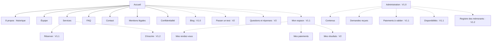

Il n'existe pas de page « Payer un service » isolée : le paiement fait partie du parcours de réservation ou d'inscription, et l'état des paiements se consulte dans « Mon espace ». Cette décision est proposée pour éviter qu'une personne paie sans avoir réservé.

## 2. Menu principal selon le mode

| Rubrique | V0 démonstration | V0 production | Activée en |
|---|---|---|---|
| Le centre (À propos, Équipe) | Visible | Visible | V0 |
| Services | Visible | Visible | V0 |
| FAQ | Visible | Visible | V0 |
| Contact | Visible | Visible | V0 |
| Blog | « Bientôt » | Masqué | V1.0 |
| Passer un test | « Bientôt » | Masqué | V2 |
| Questions et réponses | « Bientôt » | Masqué | V2 |
| Se connecter | « Bientôt » | Masqué | V1.1 |
| Bouton principal | Nous contacter | Nous contacter | Devient Prendre rendez-vous en V1.1 |

Une rubrique « Bientôt » n'est pas cliquable et ne mène à aucune page vide.

## 3. V0 : le visiteur contacte le centre

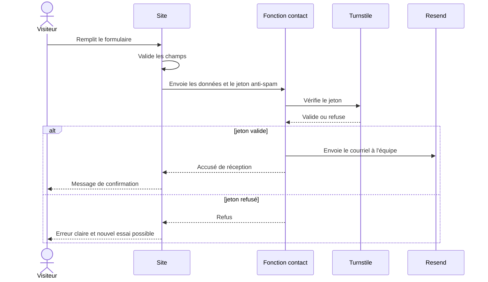

**Écran Contact** : coordonnées cliquables, adresse, mention d'urgence, formulaire (nom, moyen de contact, service concerné, message), avertissement de confidentialité. Un visiteur qui arrive depuis une carte service voit le service déjà sélectionné.

**V1.0** : la même fonction enregistre aussi la demande dans la base ; l'équipe la consulte dans l'administration avec un statut (nouvelle, en cours, traitée, archivée).

## 4. Le bouton d'action d'un service

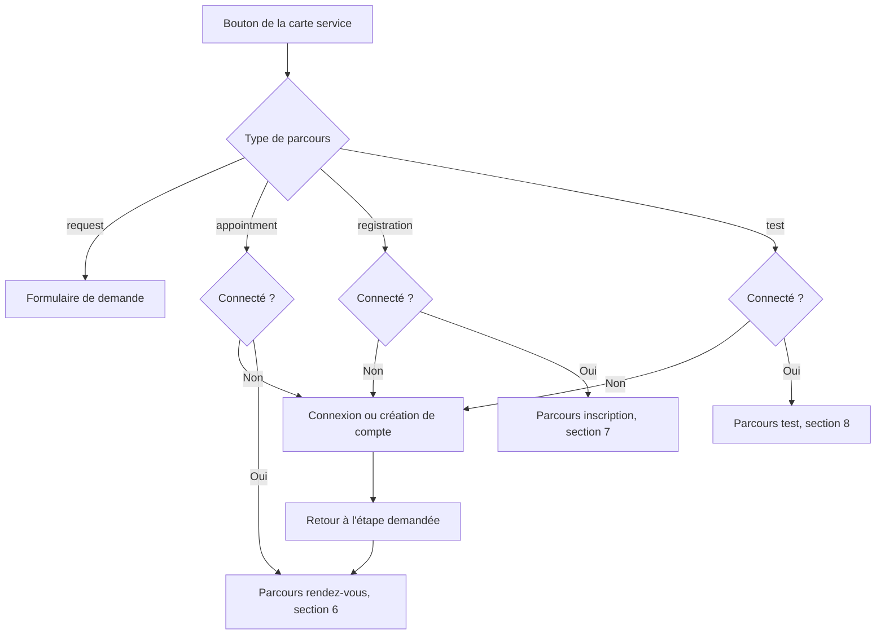

| Type | Libellé du bouton | Disponible |
|---|---|---|
| `request` | Nous contacter | V0 |
| `appointment` | Prendre rendez-vous | V1.1 |
| `registration` | S'inscrire | V1.2 |
| `test` | Commencer le test | V2 |

En V0, tous les services sont de type `request`. Passer un service à un autre type en V1 se fait en modifiant sa fiche, sans changer l'interface.

## 5. Compte et accès (V1.0 et V1.1)

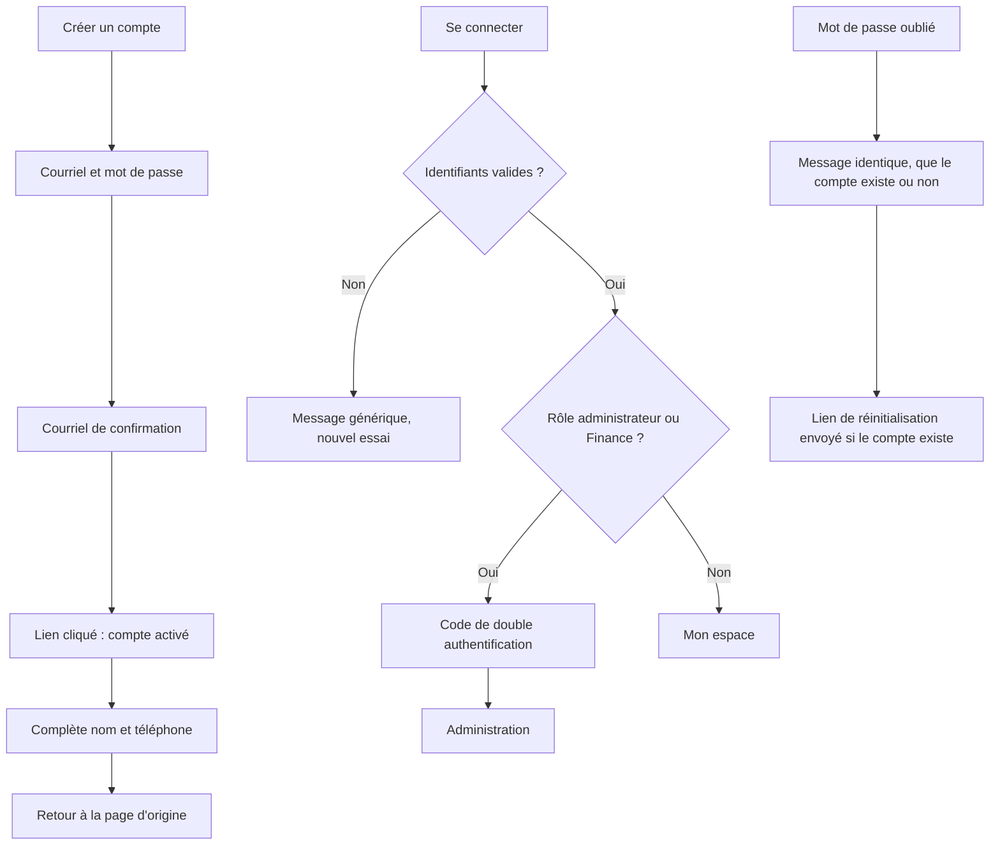

## 6. Rendez-vous (V1.1)

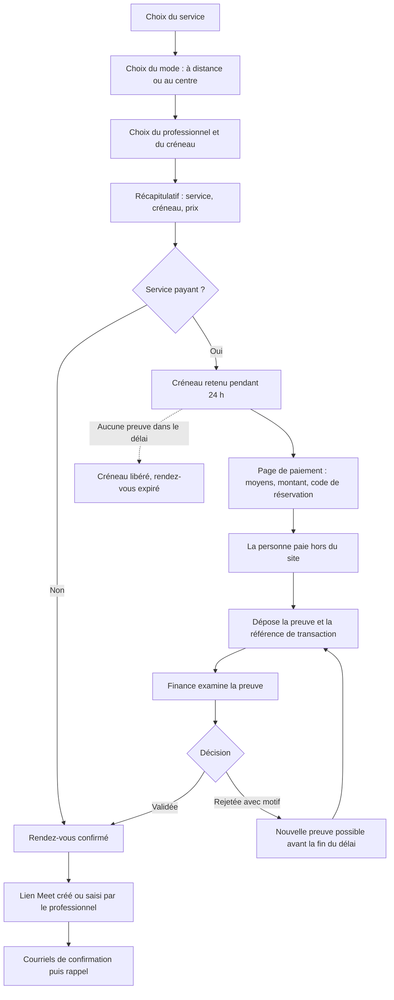

**Statuts du rendez-vous**

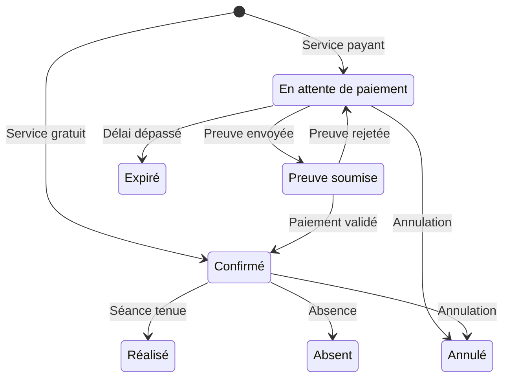

**Statuts du paiement**

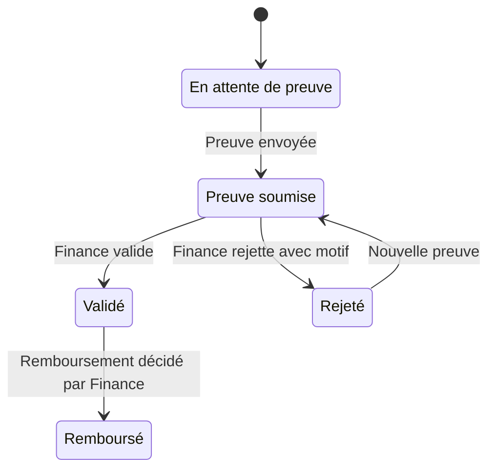

**Règles**
1. Le créneau est réservé pour la durée du délai (24 h par défaut) ; deux personnes ne peuvent jamais retenir le même créneau.
2. Un rendez-vous payant n'est **jamais** confirmé avant la validation de la preuve.
3. Les numéros de paiement ne sont montrés qu'à une personne connectée ayant une réservation en attente.
4. Chaque décision de Finance enregistre l'auteur, la date et le motif.
5. Le lien Meet n'est créé qu'à la confirmation ; si la création automatique échoue, le professionnel est alerté et peut coller un lien.
6. Un rendez-vous concernant un mineur est réservé par un responsable légal, avec une case dédiée (PRD-Q12).

## 7. Inscriptions et registre des mémorants (V1.2)

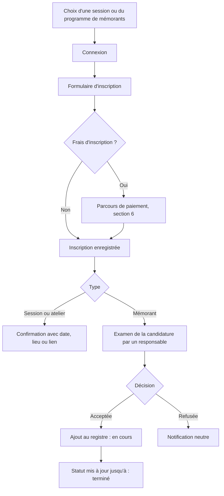

Le registre est consultable par les rôles autorisés, avec recherche, filtre par statut et export CSV.

## 8. Test psychologique (V2)

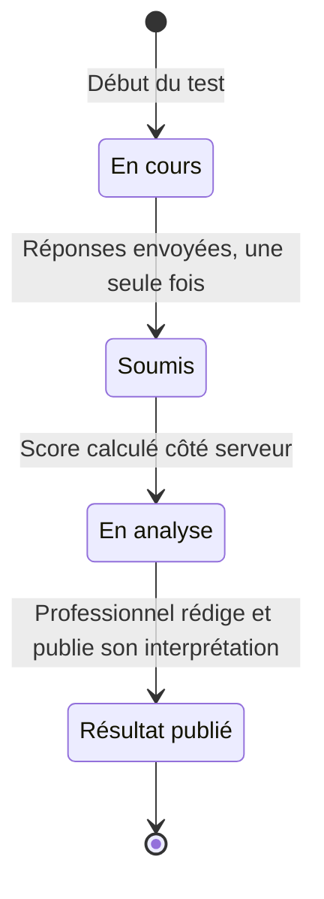

- Avant la publication, la personne voit uniquement : « Vos réponses sont enregistrées. Vous serez prévenu(e) quand votre résultat sera disponible. »
- La notification de publication est neutre ; le détail s'affiche dans « Mon espace ».
- Le score brut n'apparaît nulle part côté personne avant la publication (RM-03).

## 9. Questions et réponses (V2)

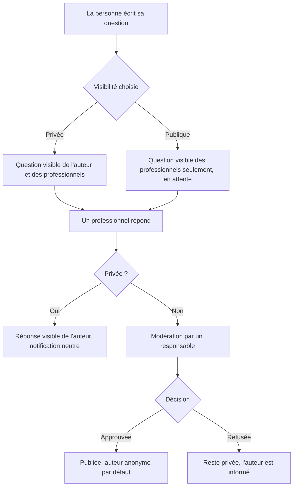

Une question publique n'apparaît jamais sur le site avant sa réponse et sa modération. Un message rappelle à l'auteur de ne pas y mettre d'information personnelle.

## 10. Blog et contenu (V1.0)

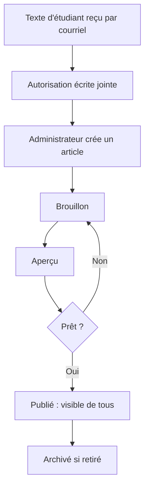

L'auteur est un nom affiché, pas un compte. Le statut « en révision » est prévu dans la base pour une soumission future par les étudiants (FR-BLG-03).

## 11. Notifications

| Événement | Destinataire | Canal | Contenu |
|---|---|---|---|
| Demande de contact reçue | Équipe | Courriel | Nom, service concerné, message |
| Compte créé | Utilisateur | Courriel | Lien de confirmation |
| Réservation retenue | Utilisateur | Courriel | Code de réservation, heure limite pour la preuve |
| Preuve soumise | Finance | Courriel | Lien vers l'administration |
| Paiement validé ou rejeté | Utilisateur | Courriel | Statut et motif éventuel, sans détail de santé |
| Rendez-vous confirmé | Utilisateur et professionnel | Courriel | Date, heure, mode, lien Meet |
| Rappel | Utilisateur | Courriel | 24 h avant |
| Résultat publié | Utilisateur | Courriel | « Un document est disponible dans votre espace » |

Aucune notification ne contient d'information de santé.

## 12. États standard

| Situation | Ce que dit l'interface | Action proposée |
|---|---|---|
| Liste vide (ex. aucun rendez-vous) | « Vous n'avez pas encore de rendez-vous. » | Bouton « Prendre rendez-vous » |
| Chargement | Indicateur de squelette de page | n/a |
| Erreur réseau | « La connexion a été interrompue. Vos informations n'ont pas été envoyées. » | Bouton « Réessayer » |
| Erreur de saisie | Message sous le champ, précisant le format attendu | Correction en place |
| Accès refusé | « Cette page est réservée à l'équipe. » | Lien vers l'accueil ou la connexion |
| Page introuvable | « Cette page n'existe pas ou a été déplacée. » | Liens vers l'accueil et les services |
| Créneau pris entre-temps | « Ce créneau vient d'être réservé. Choisissez-en un autre. » | Retour à la liste des créneaux |

Chaque erreur dit ce qui s'est passé et ce qu'il faut faire ensuite.

## 13. Informations manquantes

| Réf | Information manquante | Question à poser au client | Réponse par défaut (suggestion) | Bloque |
|---|---|---|---|---|
| FLW-Q01 | Réservation sans compte | Une personne peut-elle réserver sans créer de compte ? | Non : compte obligatoire (suivi des paiements, sécurité) | V1.1 |
| FLW-Q02 | Mode de connexion | Mot de passe ou lien envoyé par courriel ? | Courriel et mot de passe, avec réinitialisation | V1.1 |
| FLW-Q03 | Délai d'examen d'une preuve | En combien de temps Finance répond-elle ? | 24 h ouvrées ; rappel automatique à Finance au-delà | V1.1 |
| FLW-Q04 | Preuve rejetée | La personne peut-elle renvoyer une preuve ? | Oui, tant que le délai de réservation n'est pas écoulé | V1.1 |
| FLW-Q05 | Annulation | Qui peut annuler et jusqu'à quand ? | Utilisateur jusqu'à 24 h avant ; professionnel à tout moment avec motif ; notification dans les deux cas | V1.1 |
| FLW-Q06 | Candidature de mémorant | Faut-il une validation avant l'ajout au registre ? | Oui, par un responsable désigné | V1.2 |
| FLW-Q07 | Sessions complètes | Liste d'attente ? | Non : inscriptions closes quand la session est complète | V1.2 |
| FLW-Q08 | Rendez-vous pour un enfant | Quelles informations demander ? | Case « concerne un mineur » et prénom de l'enfant, rien d'autre | V1.1 |
| FLW-Q09 | Langue des notifications | Français seulement ? | Français | Non bloquant |

## 14. Les interdits

**Navigation**
- Aucune impasse : chaque écran, y compris les erreurs, propose une action suivante.
- Aucun lien mort ni rubrique vide visible en production.
- Aucun libellé de bouton variable pour une même action : une action garde son nom sur tout le parcours (« Prendre rendez-vous » donne « Rendez-vous demandé »).

**Sécurité des parcours**
- Ne jamais indiquer si une adresse courriel possède déjà un compte (connexion, réinitialisation, inscription).
- Ne jamais accepter une redirection vers une adresse externe après la connexion.
- Ne jamais exposer l'identifiant d'un objet d'autrui : l'accès se vérifie côté serveur, pas par le secret de l'URL.
- Ne jamais afficher les moyens de paiement à une personne non connectée ou sans réservation en attente.
- Ne jamais autoriser un envoi de formulaire illimité : anti-spam et limitation de débit partout.

**Règles métier**
- Ne jamais confirmer un rendez-vous payant sans validation de la preuve.
- Ne jamais réserver un créneau sans verrou de durée limitée.
- Ne jamais publier une question, un résultat ou un article sans l'étape de validation prévue.
- Ne jamais effectuer une action irréversible (annulation, rejet de paiement, suppression) sans confirmation explicite.
- Ne jamais envoyer d'information de santé dans une notification.

## Journal des modifications

| Date | Version | Modification | Auteur |
|---|---|---|---|
| 13/11/2026 | 0.1 | Création | Développeur |
