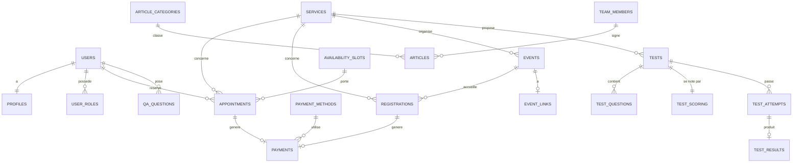

# Backend Schema : base de données, sécurité et stockage
**Plateforme CAP-MARJ**

| Champ | Valeur |
|---|---|
| Version du document | 0.1 |
| Statut | Brouillon, à valider avant la première migration (V1.0) |
| Dernière mise à jour | 13 novembre 2026 |
| Phases couvertes | V0 (seed JSON, aucune base), V1.0 à V1.2, V2 |
| Documents liés | [PRD](01_PRD_Exigences_Produit.md) · [TRD](02_TRD_Exigences_Techniques.md) · [Appflow](03_Appflow.md) · [UX/UI](04_UX_UI_Design.md) · [Plan](06_Plan_Implementation.md) |
| Rôle de ce document | Source de vérité du **modèle de données et des règles d'accès**. Les migrations du dépôt (`supabase/migrations/`) doivent toujours refléter ce document. |

Les identifiants techniques sont en anglais (colonnes, tables, statuts) ; ils correspondent aux statuts de l'Appflow.

---

## 1. Principes

1. **Évolution additive** : on ajoute, on assouplit, on ne casse pas (section 10).
2. **RLS activée sur toutes les tables** du schéma `public`, sans exception. Une table sans politique n'est lisible par personne.
3. **Toute écriture sensible passe par une fonction serveur** (RPC `security definer`) qui valide la règle métier ; les utilisateurs n'ont pas de droit d'écriture direct sur rendez-vous, paiements, résultats.
4. **Types stricts** : identifiants `uuid`, dates `timestamptz`, montants `numeric(12,2)`, statuts en énumérations. Jamais de `float` pour l'argent.
5. **Pas de suppression physique** des données financières : les statuts portent l'historique, le journal d'audit trace les décisions.
6. **Le seed JSON de la V0 a la même forme que les tables** : il sert de `seed.sql` et de jeu de tests.

## 2. Tables par version

| Version | Tables | Rôle |
|---|---|---|
| V0 | Aucune (fichiers `src/data/seed/*.json`) | Contenu de démonstration, forme identique aux futures tables |
| V1.0 | `profiles`, `user_roles`, `organisation`, `axes`, `team_members`, `services`, `faq_items`, `article_categories`, `articles`, `contact_requests`, `audit_log` | Contenu administrable, blog, demandes |
| V1.1 | `professional_services`, `availability_slots`, `appointments`, `payment_methods`, `payments` | Rendez-vous et preuves de paiement |
| V1.2 | `events`, `event_links`, `registrations`, vue `memorant_register` | Sessions, inscriptions, registre |
| V2 | `tests`, `test_scoring`, `test_questions`, `test_attempts`, `test_results`, `qa_questions` | Tests et Questions/Réponses |



## 3. Fondations (migration `0001_base`)

```sql
create extension if not exists btree_gist;

create type app_role           as enum ('admin', 'professional', 'finance');
create type workflow_type      as enum ('request', 'appointment', 'registration', 'test');
create type article_status     as enum ('draft', 'in_review', 'published', 'archived');
create type request_status     as enum ('new', 'in_progress', 'handled', 'archived');
create type appointment_mode   as enum ('remote', 'in_person');
create type appointment_status as enum ('pending_payment', 'proof_submitted', 'confirmed',
                                        'completed', 'cancelled', 'expired', 'no_show');
create type payment_method_type as enum ('moncash', 'natcash', 'bank_deposit');
create type payment_status     as enum ('awaiting_proof', 'proof_submitted', 'validated',
                                        'rejected', 'refunded');
create type registration_status as enum ('submitted', 'under_review', 'accepted', 'rejected',
                                         'active', 'completed', 'cancelled');
create type attempt_status     as enum ('in_progress', 'submitted', 'under_review', 'released');
create type qa_visibility      as enum ('public', 'private');
create type qa_status          as enum ('pending', 'answered', 'published', 'rejected');

create or replace function public.set_updated_at()
returns trigger language plpgsql as $$
begin
  new.updated_at = now();
  return new;
end $$;
```

## 4. V1.0 : identité, contenu, demandes

### 4.1 Comptes et rôles (`0002_auth_roles`)

```sql
create table public.profiles (
  id         uuid primary key references auth.users (id) on delete cascade,
  full_name  text,
  phone      text,
  created_at timestamptz not null default now(),
  updated_at timestamptz not null default now()
);

create table public.user_roles (
  user_id    uuid not null references auth.users (id) on delete cascade,
  role       app_role not null,
  granted_by uuid references auth.users (id),
  created_at timestamptz not null default now(),
  primary key (user_id, role)
);

create or replace function public.has_role(_role app_role)
returns boolean language sql stable security definer set search_path = public as $$
  select exists (
    select 1 from public.user_roles where user_id = auth.uid() and role = _role
  );
$$;

create or replace function public.handle_new_user()
returns trigger language plpgsql security definer set search_path = public as $$
begin
  insert into public.profiles (id, full_name)
  values (new.id, new.raw_user_meta_data ->> 'full_name');
  return new;
end $$;

create trigger on_auth_user_created
  after insert on auth.users
  for each row execute function public.handle_new_user();
```

Le rôle n'est **jamais** lu dans `user_metadata` (modifiable par l'utilisateur). Seul un administrateur peut écrire dans `user_roles`.

### 4.2 Contenu (`0003_content`)

```sql
create table public.organisation (
  id          smallint primary key default 1 check (id = 1),   -- une seule ligne
  legal_name  text not null,
  short_name  text not null,
  email       text not null,
  phones      text[] not null default '{}',
  address     text,
  tax_id      text,
  founded_on  date,
  history     text,
  updated_at  timestamptz not null default now()
);

create table public.axes (
  id           uuid primary key default gen_random_uuid(),
  slug         text not null unique check (slug ~ '^[a-z0-9-]+$'),
  name         text not null,
  summary      text not null,
  position     int  not null default 0,
  is_published boolean not null default true
);

create table public.team_members (
  id            uuid primary key default gen_random_uuid(),
  full_name     text not null,
  display_title text not null,
  short_bio     text not null,
  full_bio      text,
  photo_path    text,
  position      int  not null default 0,
  is_published  boolean not null default true,
  created_at    timestamptz not null default now(),
  updated_at    timestamptz not null default now()
);

create table public.services (
  id            uuid primary key default gen_random_uuid(),
  slug          text not null unique check (slug ~ '^[a-z0-9-]+$'),
  name          text not null,
  summary       text not null,
  audience      text,
  inclusions    text[] not null default '{}',
  is_paid       boolean not null default false,
  price_amount  numeric(12,2) check (price_amount is null or price_amount >= 0),
  price_currency char(3) not null default 'HTG' check (price_currency in ('HTG', 'USD')),
  price_note    text,                       -- ex. « Sur devis »
  workflow_type workflow_type not null default 'request',
  cta_label     text not null default 'Nous contacter',
  position      int  not null default 0,
  is_published  boolean not null default false,
  created_at    timestamptz not null default now(),
  updated_at    timestamptz not null default now(),
  constraint free_service_has_no_price check (is_paid or price_amount is null),
  constraint paid_service_has_price_or_note check (not is_paid or price_amount is not null or price_note is not null)
);

create table public.faq_items (
  id           uuid primary key default gen_random_uuid(),
  question     text not null,
  answer       text not null,
  position     int  not null default 0,
  is_published boolean not null default true
);

create table public.article_categories (
  slug text primary key check (slug ~ '^[a-z0-9-]+$'),
  name text not null,
  position int not null default 0
);

create table public.articles (
  id               uuid primary key default gen_random_uuid(),
  slug             text not null unique check (slug ~ '^[a-z0-9-]+$'),
  title            text not null,
  excerpt          text,
  body_markdown    text not null,
  cover_path       text,
  category_slug    text not null references public.article_categories (slug),
  author_name      text not null,                          -- crédit affiché, pas un compte
  author_member_id uuid references public.team_members (id) on delete set null,
  status           article_status not null default 'draft',
  published_at     timestamptz,
  created_by       uuid references auth.users (id),
  created_at       timestamptz not null default now(),
  updated_at       timestamptz not null default now(),
  constraint published_has_date check (status <> 'published' or published_at is not null)
);

-- Déclencheurs updated_at : un par table concernée
create trigger trg_services_updated before update on public.services
  for each row execute function public.set_updated_at();
-- (idem team_members, articles, profiles, organisation)
```

### 4.3 Demandes et audit (`0004_requests_audit`)

```sql
create table public.contact_requests (
  id            uuid primary key default gen_random_uuid(),
  service_id    uuid references public.services (id) on delete set null,
  contact_name  text not null,
  contact_email text,
  contact_phone text,
  message       text not null check (char_length(message) between 10 and 4000),
  status        request_status not null default 'new',
  handled_by    uuid references auth.users (id),
  created_at    timestamptz not null default now(),
  updated_at    timestamptz not null default now(),
  constraint has_a_contact check (contact_email is not null or contact_phone is not null)
);

create table public.audit_log (
  id         bigint generated always as identity primary key,
  actor_id   uuid references auth.users (id),
  action     text not null,
  entity     text not null,
  entity_id  text,
  metadata   jsonb not null default '{}',
  created_at timestamptz not null default now()
);
```

`contact_requests` n'a **aucune politique d'insertion publique** : l'insertion passe par la fonction serveur (clé de service) après vérification anti-spam.

## 5. V1.1 : rendez-vous et paiements (`0005_scheduling`, `0006_payments`)

```sql
create table public.professional_services (
  professional_id uuid not null references auth.users (id) on delete cascade,
  service_id      uuid not null references public.services (id) on delete cascade,
  primary key (professional_id, service_id)
);

create table public.availability_slots (
  id              uuid primary key default gen_random_uuid(),
  professional_id uuid not null references auth.users (id) on delete cascade,
  starts_at       timestamptz not null,
  ends_at         timestamptz not null,
  mode            appointment_mode not null,
  is_blocked      boolean not null default false,
  created_at      timestamptz not null default now(),
  constraint slot_order check (ends_at > starts_at),
  constraint no_overlapping_slots exclude using gist (
    professional_id with =, tstzrange(starts_at, ends_at) with &&
  )
);

create table public.appointments (
  id              uuid primary key default gen_random_uuid(),
  reference       text not null unique,            -- code de réservation lisible
  user_id         uuid not null references auth.users (id),
  service_id      uuid not null references public.services (id),
  slot_id         uuid not null references public.availability_slots (id),
  professional_id uuid not null references auth.users (id),
  mode            appointment_mode not null,
  for_minor       boolean not null default false,
  minor_first_name text,
  status          appointment_status not null,
  hold_expires_at timestamptz,
  meet_url        text,
  calendar_event_id text,
  cancelled_by    uuid references auth.users (id),
  cancel_reason   text,
  created_at      timestamptz not null default now(),
  updated_at      timestamptz not null default now(),
  constraint minor_needs_first_name check (not for_minor or minor_first_name is not null)
);

-- Un créneau ne peut porter qu'un seul rendez-vous actif : la base garantit l'unicité.
create unique index appointments_one_active_per_slot
  on public.appointments (slot_id)
  where status in ('pending_payment', 'proof_submitted', 'confirmed');

create table public.payment_methods (
  id             uuid primary key default gen_random_uuid(),
  type           payment_method_type not null,
  label          text not null,
  account_number text not null,
  account_holder text not null,
  instructions   text,
  is_active      boolean not null default true,
  position       int not null default 0
);

create table public.payments (
  id                    uuid primary key default gen_random_uuid(),
  user_id               uuid not null references auth.users (id),
  service_id            uuid not null references public.services (id),
  appointment_id        uuid references public.appointments (id),
  registration_id       uuid,                          -- clé étrangère ajoutée en V1.2
  method_id             uuid references public.payment_methods (id),
  amount                numeric(12,2) not null check (amount > 0),   -- instantané du prix à la réservation
  currency              char(3) not null default 'HTG',
  status                payment_status not null default 'awaiting_proof',
  transaction_reference text,
  proof_path            text,
  submitted_at          timestamptz,
  reviewed_by           uuid references auth.users (id),
  reviewed_at           timestamptz,
  rejection_reason      text,
  created_at            timestamptz not null default now(),
  updated_at            timestamptz not null default now(),
  constraint exactly_one_target check (num_nonnulls(appointment_id, registration_id) = 1),
  constraint reference_with_proof check (status = 'awaiting_proof' or transaction_reference is not null),
  constraint rejection_needs_reason check (status <> 'rejected' or rejection_reason is not null)
);

create unique index payments_one_per_appointment on public.payments (appointment_id)
  where appointment_id is not null;

-- Une même référence de transaction ne peut pas servir deux fois pour un même moyen de paiement.
create unique index payments_unique_reference on public.payments (method_id, lower(transaction_reference))
  where transaction_reference is not null and status in ('proof_submitted', 'validated');
```

**Fonctions serveur (RPC)** : seules voies d'écriture pour les utilisateurs.

| Fonction | Rôle autorisé | Comportement |
|---|---|---|
| `book_appointment(service, slot, for_minor, minor_first_name)` | Utilisateur connecté | Vérifie créneau libre et futur ; crée le rendez-vous (`pending_payment` ou `confirmed`) avec `hold_expires_at` à +24 h ; crée le paiement avec le prix en vigueur |
| `submit_payment_proof(payment, method, reference, proof_path)` | Propriétaire du paiement | Vérifie délai et fichier ; passe le paiement et le rendez-vous à `proof_submitted` |
| `review_payment(payment, approve, reason)` | Finance ou administrateur | Valide ou rejette ; met à jour le rendez-vous ; écrit dans `audit_log` ; déclenche la création du lien Meet |
| `cancel_appointment(appointment, reason)` | Propriétaire (≥ 24 h avant) ou professionnel | Libère le créneau ; notifie |
| `expire_holds()` | Tâche planifiée toutes les 5 min | Passe en `expired` les rendez-vous `pending_payment` dont `hold_expires_at` est dépassé |

```sql
create or replace function public.expire_holds()
returns void language sql security definer set search_path = public as $$
  update public.appointments
     set status = 'expired', updated_at = now()
   where status = 'pending_payment'
     and hold_expires_at is not null
     and hold_expires_at < now();
$$;
```

## 6. V1.2 : sessions et inscriptions (`0007_events_registrations`)

```sql
create table public.events (
  id                    uuid primary key default gen_random_uuid(),
  service_id            uuid references public.services (id) on delete set null,
  title                 text not null,
  description           text,
  starts_at             timestamptz not null,
  ends_at               timestamptz,
  location              text,
  capacity              int check (capacity is null or capacity > 0),
  registration_deadline timestamptz,
  fee_amount            numeric(12,2) check (fee_amount is null or fee_amount >= 0),
  fee_currency          char(3) not null default 'HTG',
  is_published          boolean not null default false,
  created_at            timestamptz not null default now(),
  updated_at            timestamptz not null default now()
);

-- Le lien de conférence n'est visible que des inscrits confirmés.
create table public.event_links (
  event_id uuid primary key references public.events (id) on delete cascade,
  url      text not null
);

create table public.registrations (
  id          uuid primary key default gen_random_uuid(),
  user_id     uuid not null references auth.users (id),
  service_id  uuid not null references public.services (id),
  event_id    uuid references public.events (id),
  kind        text not null check (kind in ('event', 'memorant')),
  status      registration_status not null default 'submitted',
  payload     jsonb not null default '{}' check (jsonb_typeof(payload) = 'object'),
  reviewed_by uuid references auth.users (id),
  reviewed_at timestamptz,
  decision_note text,
  created_at  timestamptz not null default now(),
  updated_at  timestamptz not null default now(),
  constraint event_needs_event check (kind <> 'event' or event_id is not null)
);

create unique index registrations_one_per_event on public.registrations (user_id, event_id)
  where event_id is not null and status not in ('cancelled', 'rejected');

alter table public.payments
  add constraint payments_registration_fk foreign key (registration_id)
  references public.registrations (id);
```

Le contenu de `payload` (université, filière, niveau, thème de mémoire…) est validé côté application par un schéma Zod par type d'inscription. La vue `memorant_register` (créée avec `security_invoker = true`) assemble profil et `payload` pour l'administration et l'export CSV.

## 7. V2 : tests et Questions/Réponses (`0008_tests`, `0009_qa`)

```sql
create table public.tests (
  id           uuid primary key default gen_random_uuid(),
  slug         text not null unique,
  service_id   uuid references public.services (id) on delete set null,
  title        text not null,
  description  text,
  instructions text,
  is_published boolean not null default false,
  created_at   timestamptz not null default now()
);

-- Grille de notation séparée : jamais lisible par les passants.
create table public.test_scoring (
  test_id uuid primary key references public.tests (id) on delete cascade,
  config  jsonb not null
);

create table public.test_questions (
  id       uuid primary key default gen_random_uuid(),
  test_id  uuid not null references public.tests (id) on delete cascade,
  position int  not null,
  prompt   text not null,
  kind     text not null check (kind in ('single_choice', 'scale', 'text')),
  options  jsonb not null default '[]',
  unique (test_id, position)
);

create table public.test_attempts (
  id           uuid primary key default gen_random_uuid(),
  test_id      uuid not null references public.tests (id),
  user_id      uuid not null references auth.users (id),
  status       attempt_status not null default 'in_progress',
  answers      jsonb not null default '{}',
  started_at   timestamptz not null default now(),
  submitted_at timestamptz
);

create unique index one_open_attempt on public.test_attempts (test_id, user_id)
  where status = 'in_progress';

-- Score et interprétation dans une table distincte : lisibles par la personne
-- seulement lorsque released_at est renseigné.
create table public.test_results (
  attempt_id     uuid primary key references public.test_attempts (id) on delete cascade,
  raw_score      jsonb not null,
  interpretation text,
  reviewed_by    uuid references auth.users (id),
  released_at    timestamptz,
  constraint release_needs_interpretation
    check (released_at is null or (interpretation is not null and reviewed_by is not null))
);

create table public.qa_questions (
  id               uuid primary key default gen_random_uuid(),
  author_id        uuid not null references auth.users (id),
  body             text not null check (char_length(body) between 10 and 2000),
  visibility       qa_visibility not null default 'private',
  status           qa_status not null default 'pending',
  show_author_name boolean not null default false,
  answer           text,
  answered_by      uuid references auth.users (id),
  answered_at      timestamptz,
  moderated_by     uuid references auth.users (id),
  moderated_at     timestamptz,
  created_at       timestamptz not null default now(),
  constraint answered_needs_answer check (status in ('pending', 'rejected') or answer is not null),
  constraint published_must_be_public check (status <> 'published' or visibility = 'public')
);
```

**Fonctions serveur V2** : `submit_test_attempt(attempt)` (calcule le score côté serveur selon `test_scoring`, passe en `under_review`), `release_test_result(attempt, interpretation)` (professionnel), `answer_question(...)`, `moderate_question(...)`.

## 8. Matrice d'accès (RLS)

Légende : **L** = lecture, **E** = écriture directe, **R** = via fonction serveur uniquement, **—** = aucun accès. « Propre » = uniquement ses propres lignes.

| Table | Anonyme | Utilisateur | Professionnel | Finance | Administrateur |
|---|---|---|---|---|---|
| `organisation`, `axes`, `faq_items`, `article_categories` | L (publié) | L | L | L | L, E |
| `team_members`, `services`, `articles` | L (publié) | L | L | L | L, E |
| `contact_requests` | — | — | — | — | L, E |
| `profiles` | — | L, E propre | L (utilisateurs de ses rendez-vous) | L (nom pour validation) | L |
| `user_roles` | — | L propre | L propre | L propre | L, E |
| `availability_slots` | L (créneaux libres) | L | L, E propre | — | L, E |
| `appointments` | — | L propre, R | L propre (ses séances), R | L | L, R |
| `payment_methods` | — | L (si réservation en attente) | — | L, E | L, E |
| `payments` | — | L propre, R | — | L, R | L, R |
| `events` | L (publié) | L | L | L | L, E |
| `event_links` | — | L (inscrit confirmé) | L | — | L, E |
| `registrations` | — | L propre, R | L (selon branche) | L | L, R |
| `tests`, `test_questions` | — | L (publiés) | L, E | — | L, E |
| `test_scoring` | — | — | L, E | — | L, E |
| `test_attempts` | — | L propre, R | L | — | L |
| `test_results` | — | L propre **si publié** | L, E | — | L, E |
| `qa_questions` | L colonnes publiques si publié | L propre, R | L, R | — | L, R |
| `audit_log` | — | — | — | L | L |

Cette matrice est la **référence des tests de politiques** : chaque cellule « — » et chaque « propre » a un test qui échoue si la règle est violée.

### Exemples de politiques

```sql
alter table public.services enable row level security;

create policy services_public_read on public.services
  for select using (is_published);

create policy services_admin_write on public.services
  for all to authenticated
  using (public.has_role('admin')) with check (public.has_role('admin'));

-- Rendez-vous : lecture seule pour les utilisateurs, écriture par RPC.
alter table public.appointments enable row level security;

create policy appointments_owner_read on public.appointments
  for select to authenticated using (user_id = auth.uid());

create policy appointments_professional_read on public.appointments
  for select to authenticated using (professional_id = auth.uid());

create policy appointments_staff_read on public.appointments
  for select to authenticated
  using (public.has_role('admin') or public.has_role('finance'));

-- Paiements
alter table public.payments enable row level security;

create policy payments_owner_read on public.payments
  for select to authenticated using (user_id = auth.uid());

create policy payments_staff_read on public.payments
  for select to authenticated
  using (public.has_role('finance') or public.has_role('admin'));

-- Résultats de test : visibles de la personne uniquement après publication.
alter table public.test_results enable row level security;

create policy results_owner_after_release on public.test_results
  for select to authenticated
  using (
    released_at is not null
    and exists (
      select 1 from public.test_attempts a
      where a.id = attempt_id and a.user_id = auth.uid()
    )
  );

-- Q/R publique : colonnes limitées + lignes publiées seulement, auteur jamais exposé.
alter table public.qa_questions enable row level security;
revoke all on public.qa_questions from anon;
grant select (id, body, answer, answered_at) on public.qa_questions to anon;

create policy qa_public_read on public.qa_questions
  for select to anon
  using (visibility = 'public' and status = 'published');
```

Avec les privilèges par colonne, un appel anonyme doit nommer les colonnes (`select=id,body,answer,answered_at`) ; `select=*` est refusé, ce qui est voulu.

## 9. Stockage

| Bucket | Accès | Contenu | Limites |
|---|---|---|---|
| `public-media` | Lecture publique ; écriture administrateur | Logo, photos équipe, couvertures d'articles | Images JPEG, PNG, WebP, AVIF ; 5 Mo |
| `payment-proofs` | **Privé** | Preuves de paiement, dossier `{user_id}/…` | JPEG, PNG, WebP, PDF ; 5 Mo |

```sql
create policy proofs_insert_own on storage.objects
  for insert to authenticated
  with check (bucket_id = 'payment-proofs' and (storage.foldername(name))[1] = auth.uid()::text);

create policy proofs_read_own_or_staff on storage.objects
  for select to authenticated
  using (
    bucket_id = 'payment-proofs'
    and ((storage.foldername(name))[1] = auth.uid()::text
         or public.has_role('finance') or public.has_role('admin'))
  );
-- Aucune politique de mise à jour ni de suppression pour les utilisateurs.
```

Les fichiers privés sont servis par URL signée de courte durée. Les noms de fichiers sont aléatoires.

## 10. Migrations et compatibilité

| Migration | Version | Contenu |
|---|---|---|
| `0001_base` | V1.0 | Extensions, énumérations, fonctions utilitaires |
| `0002_auth_roles` | V1.0 | `profiles`, `user_roles`, `has_role`, déclencheur d'inscription |
| `0003_content` | V1.0 | Contenu administrable et blog |
| `0004_requests_audit` | V1.0 | Demandes de contact, journal d'audit |
| `0005_scheduling` | V1.1 | Disponibilités, rendez-vous |
| `0006_payments` | V1.1 | Moyens de paiement, paiements, fonctions RPC |
| `0007_events_registrations` | V1.2 | Sessions, inscriptions, vue du registre |
| `0008_tests` | V2 | Tests et résultats |
| `0009_qa` | V2 | Questions/Réponses |

**Règles de compatibilité**
1. Une migration appliquée n'est jamais modifiée ; on en ajoute une nouvelle.
2. Autorisé sans risque : ajouter une table, une colonne nullable ou avec valeur par défaut, une valeur d'énumération, un index ; assouplir une contrainte.
3. À planifier : resserrer une contrainte (nettoyer les données d'abord), changer un type.
4. Interdit sans plan documenté : renommer ou supprimer une colonne ou une table. Procédure : ajouter la nouvelle, copier, basculer le code, supprimer au moins deux versions plus tard.
5. Retour arrière : migration corrective vers l'avant, testée sur l'environnement de test.
6. Chaque migration est testée sur une base de test avec les données du seed, puis les tests de politiques sont rejoués.
7. Les types TypeScript sont générés à partir de la base et comparés aux schémas Zod du dépôt.

## 11. Correspondance avec le seed de la V0

| Fichier seed | Table | Remarque |
|---|---|---|
| `organisation.json` | `organisation` | Une seule entrée |
| `axes.json` | `axes` | Quatre entrées |
| `equipe.json` | `team_members` | `display_title`, `short_bio`, `full_bio` à produire à partir des présentations reçues |
| `services.json` | `services` | Type `request` pour tous en V0 |
| `faq.json` | `faq_items` | Questions réécrites et réponses validées |
| `moyens-paiement.json` | `payment_methods` | **Hors dépôt public** : saisis par l'administration ou le script de seed du client |

Les clés du JSON sont en camelCase (contrat Zod), les colonnes en snake_case ; l'adaptateur fait la conversion à un seul endroit.

## 12. Informations manquantes

| Réf | Information manquante | Question à poser au client | Réponse par défaut (suggestion) | Bloque |
|---|---|---|---|---|
| DB-Q01 | Devise | Les prix seront-ils en gourdes, en dollars, ou les deux ? | Gourdes (HTG) par défaut ; dollars (USD) possible par service | V1.1 |
| DB-Q02 | Conservation et suppression des données | Que faire quand une personne demande la suppression de son compte ? Combien de temps garder les paiements ? | Anonymisation du profil ; conservation des paiements et rendez-vous passés pour la comptabilité ; durées fixées avec les juristes (voir PRD-Q13) | V1.1 |
| DB-Q03 | Professionnels réservables | Quels professionnels offrent quels services ? | Chaque service est lié à un ou plusieurs professionnels ; l'utilisateur choisit ou prend « le premier disponible » | V1.1 |
| DB-Q04 | Fuseau horaire | Quel fuseau afficher ? | America/Port-au-Prince ; stockage en UTC | V1.1 |
| DB-Q05 | Paiement en plusieurs fois, forfaits de suivi | Le suivi psychothérapeutique se paie-t-il par séance ou par forfait ? | Un paiement par rendez-vous ; forfaits hors V1 | V1.1 |
| DB-Q06 | Champs du registre des mémorants | Voir PRD-Q21 | Nom, prénom, courriel, téléphone, université, filière, niveau, thème de mémoire, statut | V1.2 |
| DB-Q07 | Structure des tests | Questions, échelles, calcul du score, seuils (voir PRD-Q14) | Un test pilote : somme de scores par sous-échelle, grille écrite par le centre | V2 |
| DB-Q08 | Capacité des professionnels | Nombre maximal de rendez-vous par jour ? | Aucune limite ; les créneaux publiés font office de limite | V1.1 |
| DB-Q09 | Politique d'anonymat du Q/R | Voir PRD-Q15 | Auteur anonyme ; `show_author_name` à faux par défaut | V2 |

## 13. Les interdits

**Sécurité**
- Aucune table sans RLS activée ; aucune politique `using (true)` sur une table contenant des données personnelles.
- Aucun rôle lu dans `user_metadata` ; aucune écriture de rôle depuis le client.
- Aucune fonction `security definer` sans `set search_path = public` (ou le schéma voulu) et sans contrôle d'autorisation explicite.
- Aucune clé de service dans le client ni dans une variable `VITE_`.
- Aucun bucket de justificatifs public ; aucune URL de fichier privé permanente.
- Aucune exposition de `author_id`, de `scoring` ou de numéros de paiement à un visiteur non autorisé.

**Données**
- Aucun montant en `float` ; aucun horodatage sans fuseau ; aucun statut en texte libre.
- Aucune suppression physique d'un paiement ou d'un rendez-vous réalisé.
- Aucune donnée clinique (notes de séance) en V1.
- Aucun fichier binaire stocké dans une colonne de la base.
- Aucun score ni interprétation lisible par la personne avant `released_at`.
- Aucune confirmation de rendez-vous payant sans paiement `validated`.

**Évolution**
- Aucune modification d'une migration déjà appliquée ; aucune modification manuelle de la base de production.
- Aucun renommage ni suppression de colonne sans la procédure de la section 10.
- Aucune valeur d'énumération retirée.

## Journal des modifications

| Date | Version | Modification | Auteur |
|---|---|---|---|
| 13/11/2026 | 0.1 | Création : schéma V1.0 à V2, matrice RLS, stockage, règles de migration | Développeur |
