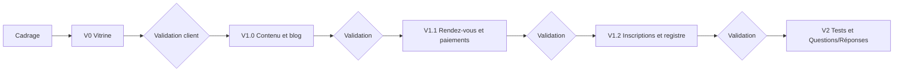

# Plan d'implémentation
**Plateforme CAP-MARJ**

| Champ | Valeur |
|---|---|
| Version du document | 0.1 |
| Statut | Brouillon, à valider avec le client avant le devis définitif |
| Dernière mise à jour | 13 novembre 2026 |
| Phases couvertes | Cadrage, V0 Vitrine, V1.0, V1.1, V1.2, V2 |
| Documents liés | [PRD](01_PRD_Exigences_Produit.md) · [TRD](02_TRD_Exigences_Techniques.md) · [Appflow](03_Appflow.md) · [UX/UI](04_UX_UI_Design.md) · [Backend Schema](05_Backend_Schema.md) |
| Rôle de ce document | Source de vérité du **quand** et du **dans quel ordre** : phases, tâches, critères de sortie, échanges avec le client, estimation |

---

## 1. Vue d'ensemble

**Règle d'enchaînement** : on ne démarre pas une phase avant la validation écrite de la précédente. Les phases peuvent être facturées par jalon.

| Phase | Objectif | Livrable présenté au client |
|---|---|---|
| Cadrage | Contenus complets et décisions en suspens | Réponses aux questions des six documents |
| V0 Vitrine | Faire valider identité, contenus, navigation | Lien de prévisualisation + démonstration |
| V1.0 | Autonomie du client sur son contenu, blog, demandes | Administration en ligne |
| V1.1 | Rendez-vous, paiement par preuve, lien Meet | Parcours complet d'un rendez-vous payant |
| V1.2 | Sessions, inscriptions, registre des mémorants | Registre exportable |
| V2 | Tests et Questions/Réponses | Modules sensibles après revue de sécurité |

## 2. Estimation (à affiner après la V0)

Les chiffres ci-dessous sont des fourchettes de travail du développeur seul, avec outils d'assistance, hors délais d'attente du client.

| Phase | Heures | Remarques |
|---|---|---|
| Cadrage et préparation des contenus | 8 à 12 | Réunion, tableau des services, rédaction FAQ et brouillons légaux |
| V0 Vitrine | 45 à 70 | Système visuel, 7 pages, formulaire de contact, déploiement |
| V1.0 | 65 à 95 | Base et migrations, authentification, administration, blog, demandes |
| V1.1 | 85 à 120 | Comptes, disponibilités, réservation, preuves, validation, Meet, rappels |
| V1.2 | 30 à 45 | Sessions, inscriptions, registre, export |
| V2 | 55 à 85 | Tests (le plus incertain), Q/R, revue de sécurité |
| **Total** | **≈ 290 à 430** | |

**Écart avec l'estimation initiale (160 à 225 h)** : le périmètre validé est plus large (quatre types de parcours, trois canaux de paiement, administration du contenu, tests, Q/R, blog) et les exigences de sécurité, d'accessibilité et de qualité sont plus strictes. À refléter dans le devis, avec une provision de 15 % pour les retours et imprévus.

## 3. Cadrage (avant le code)

| Tâche | Responsable | Sortie |
|---|---|---|
| CAD-1 | Réunion de cadrage avec le client : passer en revue les questions des six documents, par ordre de blocage | Compte rendu validé par écrit |
| CAD-2 | Envoi du tableau pré-rempli des services (PRD-Q06) | Services complétés |
| CAD-3 | Récupération des photos et du logo exploitable (UX-Q01, UX-Q03) | Dossier `assets/` complet |
| CAD-4 | Rédaction FAQ (8 questions pratiques) et brouillons légaux | Textes envoyés au client et aux juristes du centre |
| CAD-5 | Ouverture des comptes au nom du centre : Vercel, Resend, nom de domaine (TRD-Q01, TRD-Q02) | Accès documentés |
| CAD-6 | Vérification que le dépôt et les trois outils de qualité fonctionnent en local | Projet initialisé |

**Questions à traiter en priorité pendant la réunion** (celles qui bloquent la V0) : PRD-Q01, Q02, Q03, Q04, Q17, Q18, Q19 ; UX-Q01, Q03, Q06 ; TRD-Q01.

## 4. V0 Vitrine

**Objectif** : présenter au client un site complet en apparence, rapide, crédible, avec ses vrais contenus, sans base de données.

| Lot | Tâches | Heures |
|---|---|---|
| V0-A Fondations | Initialiser le dépôt (Vite, React, TypeScript strict) ; ESLint, Prettier, Vitest ; variables de design (UX/UI §4) ; polices auto-hébergées ; en-têtes de sécurité ; CI | 8 à 12 |
| V0-B Données | Contrats Zod ; seed JSON à partir du formulaire ; interfaces de dépôt et adaptateur mock ; configuration des interrupteurs et du mode démonstration | 6 à 9 |
| V0-C Composants | Boutons, champs, fiche service, fiche équipe, accordéon, badge, mention d'urgence, en-tête et pied de page, menu mobile | 10 à 14 |
| V0-D Pages | Accueil (toutes sections), À propos, Équipe, Contact, mentions légales, confidentialité, 404 | 14 à 20 |
| V0-E Contact | Fonction serveur, Turnstile, Resend, états de succès et d'erreur | 4 à 6 |
| V0-F Qualité | Responsive 360, 768, 1280 ; accessibilité clavier et lecteur d'écran ; Lighthouse ; contrôle de la section 12 de l'UX/UI | 6 à 9 |
| V0-G Livraison | Déploiement de prévisualisation, script de démonstration, grille de retours | 2 à 3 |

**Ordre conseillé** : A, B, puis C et D en alternance (l'accueil d'abord), E, F, G. La page d'accueil complète est présentable dès la moitié du lot D.

**Critères de sortie** : les critères d'acceptation du PRD §8 sont tous remplis ; la démonstration est faite ; le client a renvoyé sa grille de retours.

## 5. Échanges avec le client

**Cadence**
| Moment | Format | Objectif |
|---|---|---|
| Début | Réunion de cadrage (45 à 60 min) | Débloquer les questions |
| Milieu de V0 | Message avec capture de l'accueil | Vérifier la direction visuelle avant de finir |
| Fin de V0 | Démonstration (20 min) + lien de prévisualisation | Validation |
| Après chaque démonstration | Retours écrits sous 5 jours ouvrés | Un seul tour consolidé |
| Fin de phase | Validation écrite | Condition de départ de la phase suivante |

**Démonstration de la V0 (script de 20 minutes)**
1. Parcours d'un visiteur sur téléphone : accueil, services, contact.
2. Les quatre axes, l'équipe, l'historique.
3. Le menu et les rubriques « Bientôt » : ce qui viendra, dans quel ordre.
4. Rappel de ce qu'il faut valider : textes, photos, couleurs, navigation.

**Grille de retours (à remplir par le client)**
| Domaine | Question | Réponse |
|---|---|---|
| Identité | Les couleurs et le style correspondent-ils au centre ? | Oui / Non / À ajuster |
| Textes | Y a-t-il des erreurs, des mots à changer, des informations manquantes ? | Liste |
| Photos | Faut-il remplacer ou ajouter des photos ? | Liste |
| Navigation | Trouve-t-on facilement ce qu'on cherche ? | Oui / Non |
| Services | Les cinq cartes décrivent-elles correctement l'offre ? | Oui / Non / À ajuster |
| Priorités | Quelle fonctionnalité à venir est la plus urgente ? | Réponse |

**Règles de gestion de projet**
- Un interlocuteur unique côté client ; les retours contradictoires sont consolidés par lui.
- Deux tours de retours inclus par phase ; au-delà, estimation séparée.
- Tout changement de périmètre passe par le PRD puis un avenant.
- Les retours arrivent par écrit, même après un appel.

## 6. V1.0 : contenu, blog, demandes

| Lot | Tâches | Heures |
|---|---|---|
| V10-A Base | Deux projets Supabase (test et production), migrations 0001 à 0004, génération des types, politiques RLS et leurs tests | 12 à 18 |
| V10-B Adaptateur | Adaptateur Supabase pour les dépôts existants ; bascule par `VITE_DATA_SOURCE` ; seed en base | 8 à 12 |
| V10-C Authentification | Connexion administrateur, double authentification, gardes de routes | 8 à 12 |
| V10-D Administration | Édition des services, équipe, FAQ, informations du centre ; téléversement d'images | 18 à 26 |
| V10-E Blog | Liste, article, éditeur Markdown avec aperçu, statuts, catégories, rendu assaini | 14 à 20 |
| V10-F Demandes | La fonction de contact enregistre en base ; boîte de réception dans l'administration | 5 à 7 |
| V10-G Sécurité et livraison | Revue de politiques, audit des dépendances, sauvegardes, formation de l'administrateur | 6 à 9 |

**Critères de sortie** : le client modifie un service, publie un article et traite une demande sans l'aide du développeur ; tous les tests de politiques passent ; aucune régression visuelle de la V0.

## 7. V1.1 : rendez-vous et paiements

| Lot | Tâches | Heures |
|---|---|---|
| V11-A Comptes | Inscription, confirmation, réinitialisation, « Mon espace » | 14 à 18 |
| V11-B Disponibilités | Gestion des créneaux par professionnel, blocage, vue calendrier | 16 à 22 |
| V11-C Réservation | Parcours, fonction `book_appointment`, verrou de 24 h, expiration planifiée | 18 à 26 |
| V11-D Paiement | Page de paiement, preuve, validation par Finance, notifications | 18 à 26 |
| V11-E Meet et courriels | Création du lien, repli manuel, confirmations et rappels | 12 à 18 |
| V11-F Qualité | Tests bout en bout (réservation, double réservation, rejet de preuve), revue de sécurité, test de restauration | 10 à 14 |

**Prérequis** : TRD-Q03 (plan Supabase avec sauvegardes) et TRD-Q04 (compte Google) résolus ; PRD-Q05, Q09, Q10, Q12 tranchés ; moyens de paiement saisis dans l'administration.
**Critères de sortie** : un rendez-vous payant va de la réservation à la confirmation avec lien Meet ; deux personnes ne peuvent pas réserver le même créneau ; la sauvegarde a été restaurée avec succès sur un environnement de test.

## 8. V1.2 : inscriptions et registre

| Lot | Tâches | Heures |
|---|---|---|
| V12-A Sessions | Gestion des sessions, lien de conférence réservé aux inscrits, places | 10 à 14 |
| V12-B Inscription | Formulaire par type, paiement des frais, confirmation | 10 à 16 |
| V12-C Registre | Vue administration, statuts, recherche, export CSV | 10 à 15 |

**Prérequis** : PRD-Q21 (champs du registre), FLW-Q06 et Q07.

## 9. V2 : tests et Questions/Réponses

| Lot | Tâches | Heures |
|---|---|---|
| V2-A Tests | Modèle de test et grille, passage, calcul serveur, analyse, publication | 35 à 55 |
| V2-B Q/R | Dépôt de question, réponse, modération, affichage public | 14 à 22 |
| V2-C Revue de sécurité dédiée | Revue des politiques, test d'intrusion de base, validation par les juristes du centre | 6 à 10 |

**Prérequis** : PRD-Q14 (tests et droits), PRD-Q15 (modération et anonymat) ; politique de confidentialité finalisée.

## 10. Risques et suivi

| Risque | Probabilité | Parade | Phase |
|---|---|---|---|
| Contenus tardifs | Élevée | La V0 ne dépend que des éléments déjà reçus ; collecte en parallèle | V0 |
| Photos insuffisantes | Moyenne | Repli visuel prévu (UX/UI §7) ; demande de nouvelles photos | V0 |
| Lien Meet automatique impossible avec le compte Gmail | Moyenne | Repli manuel prévu dès le départ | V1.1 |
| Retours en désordre ou tardifs | Moyenne | Un tour consolidé, délai de 5 jours, validation écrite | Toutes |
| Preuves de paiement frauduleuses | Moyenne | Référence unique, validation humaine, journal d'audit | V1.1 |
| Sous-estimation des tests | Élevée | Test pilote unique, estimation révisée à l'entrée de V2 | V2 |
| Dépendance à un développeur unique | Moyenne | Documentation à jour, comptes au nom du client, dépôt accessible | Toutes |
| Dérive du périmètre | Élevée | Avenant systématique, PRD comme référence | Toutes |

## 11. Gouvernance des documents

| Événement | Documents à mettre à jour |
|---|---|
| Nouvelle exigence ou décision du client | PRD (puis les autres si impactés) |
| Choix technique, changement de bibliothèque | TRD (et ADR) |
| Nouvel écran ou nouveau statut | Appflow, puis Backend Schema si la base change |
| Nouvelle couleur, composant ou règle visuelle | UX/UI |
| Nouvelle table, colonne ou politique | Backend Schema (avant la migration) |
| Fin ou report d'une tâche | Plan |

**Règles**
1. Chaque modification ajoute une ligne au **journal des modifications** du document, avec la date et le numéro de version.
2. Une question client résolue est retirée du tableau « Informations manquantes » et sa réponse est reportée dans le corps du document ; la date est consignée dans le journal.
3. Un document n'est pas considéré comme à jour tant que les autres ne sont pas cohérents avec lui.
4. Les six documents sont versionnés dans le dépôt, dossier `docs/`.
5. Avant chaque démonstration, relire les sections « Les interdits » des documents concernés.

## 12. Définition de « terminé » par tâche

Une tâche est terminée quand :
- le code est relu, typé, sans avertissement de lint ;
- les tests correspondants existent et passent ;
- l'accessibilité clavier et les contrastes sont vérifiés ;
- l'affichage est contrôlé à 360, 768 et 1280 px ;
- aucune erreur n'apparaît dans la console ;
- aucune donnée de test ou de démonstration n'est présentée comme réelle ;
- les documents concernés sont mis à jour.

## 13. Informations manquantes

| Réf | Information manquante | Question à poser au client | Réponse par défaut (suggestion) | Bloque |
|---|---|---|---|---|
| PLN-Q01 | Date visée pour la présentation et le lancement | Y a-t-il un événement ou une échéance à respecter ? | Démonstration V0 sous 3 semaines après réception des contenus ; V1.0 environ 6 semaines après validation de la V0 | Planification |
| PLN-Q02 | Interlocuteur unique du projet | Qui valide au nom du centre ? | Le fondateur, ou une personne qu'il désigne par écrit | CAD-1 |
| PLN-Q03 | Disponibilité du client pour les validations | Combien de temps pour répondre ? | 5 jours ouvrés par retour | Rythme du projet |
| PLN-Q04 | Modalités de facturation par jalon | Facturation à la fin de chaque phase ? Acompte au démarrage ? | Acompte au lancement, solde par phase livrée | Devis |
| PLN-Q05 | Prise en charge des coûts d'hébergement | Le centre paie-t-il directement domaine, hébergement, base de données ? | Oui, comptes au nom du centre | CAD-5 |
| PLN-Q06 | Formation des utilisateurs | Qui doit être formé, combien de personnes ? | Administrateur et Finance : deux séances d'une heure plus un guide écrit | V1.0, V1.1 |
| PLN-Q07 | Maintenance après livraison | Quel niveau de support est attendu ? | Forfait mensuel modeste, révisé après six mois | Devis |
| PLN-Q08 | Délai de validation des textes légaux | Qui les relit et en combien de temps ? | Les juristes du centre, sous 10 jours | V0 mise en production |

## 14. Les interdits

**Déroulement**
- Ne jamais démarrer une phase avant la validation écrite de la précédente.
- Ne jamais développer une fonctionnalité hors de la phase en cours sans mettre à jour le PRD et obtenir l'accord du client.
- Ne jamais promettre de date ou de prix sans provision pour les retours et les imprévus.
- Ne jamais ouvrir des comptes d'hébergement au nom du développeur pour un client qui n'en a pas connaissance.

**Qualité**
- Ne jamais présenter au client une démonstration sans avoir passé le contrôle de l'UX/UI §12.
- Ne jamais livrer sans avoir mis à jour les six documents concernés.
- Ne jamais déployer en production sans la liste de contrôle de la section 12.
- Ne jamais travailler directement sur la base de production.
- Ne jamais laisser un lien de menu mort, un texte factice ou une donnée fictive en production.

**Échanges**
- Ne jamais accepter une demande de modification donnée uniquement à l'oral.
- Ne jamais envoyer au client plusieurs liens de prévisualisation concurrents.
- Ne jamais publier un texte institutionnel, légal ou un témoignage sans validation écrite.
- Ne jamais mettre en ligne les données réelles des bénéficiaires avant le test de restauration et la revue de sécurité de la V1.1.

## Journal des modifications

| Date | Version | Modification | Auteur |
|---|---|---|---|
| 13/11/2026 | 0.1 | Création : phases, lots, critères de sortie, cadence des échanges, gouvernance documentaire | Développeur |
